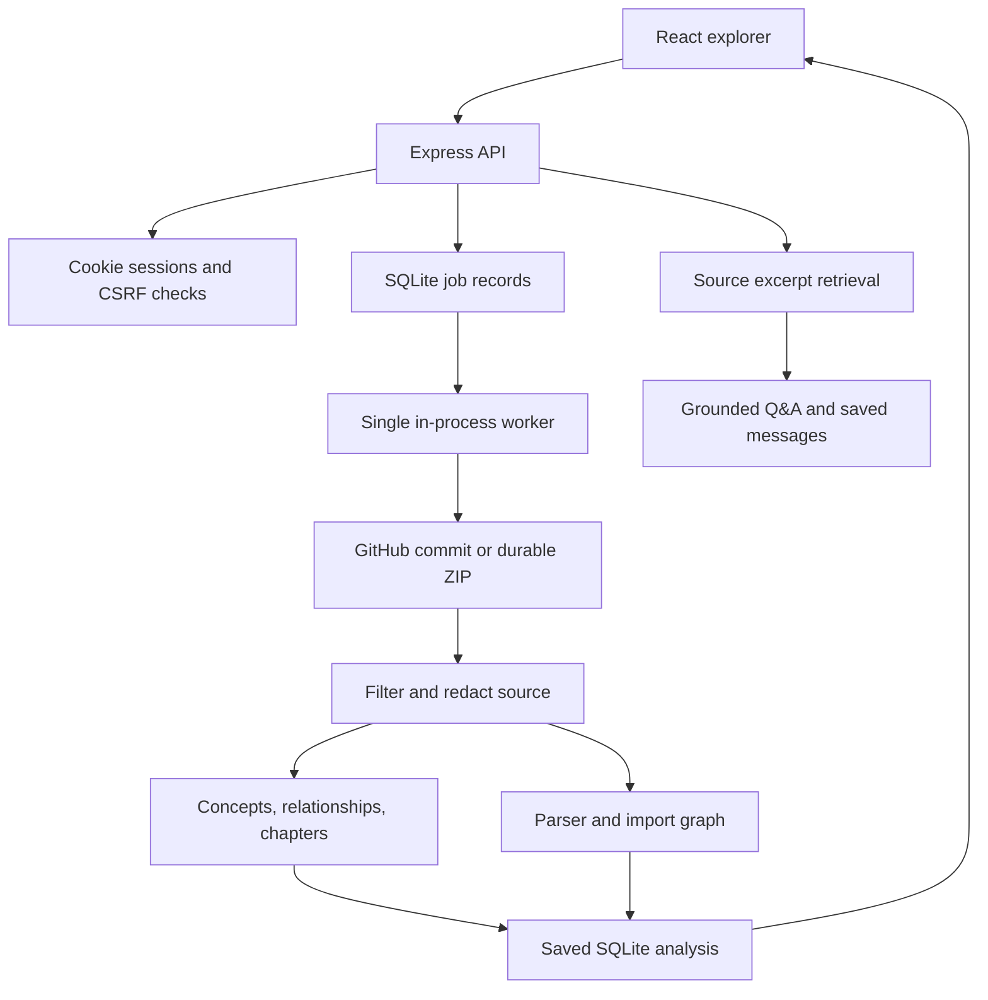

# CodeLens

### Less lost in code. More building.

A website for developers and students to understand unfamiliar codebases. Bring a public GitHub repository or project ZIP, explore its structure, and learn how the pieces fit together.

[Host the website](DEPLOYMENT.md) · [Release roadmap](RELEASE_CHECKLIST.md) · [Development setup](#develop-locally)

## A workspace for understanding code

CodeLens is a browser-based product for developers joining unfamiliar projects and students learning from real codebases. The public website introduces the workflow; invited users sign in to a persistent analysis workspace.

- **Bring a project:** import a public GitHub repository or upload a ZIP.
- **Find your bearings:** explore source files, inspect metrics, and navigate import relationships.
- **Learn in context:** use guided tutorials and source-backed Q&A when AI is configured.
- **Keep your progress:** reopen saved analyses and export a Markdown report.

The website includes a responsive public landing page, interactive product illustration, dedicated sign-in experience, and desktop/mobile workspace. Illustrations are labelled examples; they do not represent live AI results.

**Release status:** invitation-only beta. Public signup, password recovery, billing, and private GitHub integration are not available yet. Follow [the release checklist](RELEASE_CHECKLIST.md) before a public launch.

## Host the website

Deploy the frontend and API together using [the deployment guide](DEPLOYMENT.md). Users visit your hosted HTTPS URL; they do not need to install Node.js or run a local server. The hosting operator configures accounts, storage, and optional AI keys.

The homepage is `/`; sign-in is `/#signin`. Authenticated visitors enter their workspace. Source exploration works without AI keys; AI features are explicitly gated until a provider is enabled. This repository has not been deployed to a public domain automatically.

## Develop locally

Install **Node.js 24** and npm, then:

```sh
npm run install-all
cp server/.env.example server/.env
```

Provider keys in `server/.env` are optional. Leave them blank for source exploration, or add one for AI features. Create a user with:

```sh
npm run user:create -- you@example.com
npm run dev
```

Passwords must contain 12–256 characters. The account command updates existing passwords and revokes their sessions. Alternatively, `LOGIN_USERS=email:password` bootstraps missing accounts; it does not change existing passwords. Avoid committing credentials.

Open the Vite URL, normally `http://localhost:5173`. Its `/api` proxy connects to `http://127.0.0.1:5000`. Set `API_PROXY_TARGET` when using a different backend port.

For an offline demonstration:

```sh
npm run dev:demo
```

Sign in with `demo@example.com` / `demo-password`. Fake mode uses canned responses and is clearly labelled. Production refuses to start with fake mode or the obsolete development authentication bypass enabled.

## Current features

- Public GitHub ingestion pinned to a commit, or bounded ZIP extraction.
- GitHub content reuse and account-scoped analysis caching. ZIP cache identity includes the archive's project name so renamed projects do not inherit old titles or explanations.
- Saved analysis history with pagination, deletion, cancellation, and restart recovery.
- Source viewer with line numbers, accessible from file lists, graph nodes, Q&A excerpts, and unambiguous tutorial references.
- Search inside source files, jump between matching lines, and download the current overview/tutorials as a Markdown report with revision and coverage metadata.
- Parser-based JavaScript/TypeScript import detection, function/class counts, re-exports, static dynamic imports, and basic module resolution. Plain-JSON tsconfig/jsconfig path mappings are supported.
- Separate built-in and package dependencies; unresolved imports and parse failures are disclosed.
- Graph filtering, file-neighborhood focus, hidden-node counts, responsive sizing, and keyboard file navigation.
- Structured AI concept/relationship validation and partial tutorial results. Retry missing tutorials without uploading source again; successful chapters are reused.
- Bounded lexical source retrieval, overview questions, line/column excerpts, citation-ID checks, and persisted conversations (latest 40 messages per analysis).
- Password hashing, cookie sessions, CSRF/origin checks, ownership checks, request limits, storage quotas, and daily AI request allowances.
- Conservative credential redaction before analysis storage/provider submission, preserving line numbers.

## Architecture



GitHub source is fetched at an immutable commit. Cacheable content is keyed by account, selected file hashes, pipeline version, and provider/model settings. Each completed job records its own revision/coverage, even when generated content is reused.

Saved results referenced by jobs are never removed by automatic cache eviction. `MAX_ANALYSES` only bounds unreferenced entries. Delete saved jobs to reclaim their analysis data after the last reference is removed. Per-account count/byte quotas prevent indefinite source growth.

The worker persists ZIP inputs before queuing and requeues interrupted jobs on restart. It restarts unfinished work rather than resuming every provider call. Successful chapters from a completed partial analysis can be reused through the retry endpoint. Pending uploads require durable storage alongside SQLite.

## Configuration

See `server/.env.example` for the full example. Process environment variables take precedence over `server/.env`, then root `.env`.

| Setting | Default / purpose |
| --- | --- |
| `LLM_PROVIDER` | `GEMINI`; also `OPENAI`, `GROQ`, `OPENROUTER` |
| `AI_MODE` | `auto` enables AI when a provider key is present; `disabled` keeps AI off |
| Provider API keys | `GEMINI_API_KEY`, `OPENAI_API_KEY`, `GROQ_API_KEY`, `OPENROUTER_API_KEY` |
| Provider model | `GEMINI_MODEL`, `OPENAI_MODEL`, `GROQ_MODEL`, `OPENROUTER_MODEL` |
| `PORT` | `5000` |
| `DB_PATH` | `server/data/codelens.db` |
| `UPLOAD_DIR` | `uploads` beside the database |
| `SESSION_TTL_HOURS` | `24` |
| `LOGIN_USERS` | Optional bootstrap-only email/password pairs |
| `MEMBER_EMAILS` | Optional allowlist, enforced on active sessions too |
| `ALLOWED_ORIGINS` | Explicit additional browser origins; same-origin accepted |
| `TRUST_PROXY_HOPS` | `0`; configure only for your actual trusted proxy topology |
| `GITHUB_TOKEN` | Optional server token for API limits; private repositories rejected |
| `REPO_MAX_FILES` / `REPO_MAX_TOTAL_BYTES` | 250 eligible files / 15 MiB |
| `ZIP_MAX_UPLOAD_BYTES` / `ZIP_MAX_TOTAL_BYTES` | 50 MiB compressed / actual extracted eligible content |
| `ZIP_MAX_FILE_COUNT` | 2,000 included files; at most 10,000 archive entries |
| `MAX_PENDING_JOBS` / `MAX_USER_PENDING_JOBS` | 20 overall / 2 per user |
| `JOB_TIMEOUT_SECONDS` | 600 |
| `MAX_ANALYSES` | 50 unreferenced cache entries |
| `MAX_USER_ANALYSES` | 100 saved distinct analyses per account |
| `MAX_USER_STORAGE_BYTES` | 200 MiB stored analysis budget; admission uses a conservative size estimate |
| `AI_DAILY_REQUEST_LIMIT` | 100 actual provider attempts per account per UTC day; retries count |
| `MAX_ACTIVE_CHATS` | 4 globally; 1 per account |
| `ANALYSIS_MAX_CHAPTERS` / `CHAPTER_CONCURRENCY` | 4 chapters / 2 concurrent calls |
| `FAKE_LLM` | Development/test responses only |

Files over 100,000 bytes and generated/vendor paths are excluded. `.env` variants and private-key files are excluded except `.env.example`. Recognizable embedded credentials are redacted, but this is not a complete secret scanner. Avoid uploading confidential material you cannot send to your selected provider. Pending ZIPs temporarily retain the original archive on disk until completion or cancellation.

Prefer same-origin production hosting. For a separately hosted frontend, `VITE_API_URL` controls the API URL at build time and the server must allow its exact origin. Cookie `SameSite=Lax` means arbitrary cross-site hosting is not supported; use a same-site domain/reverse proxy. Production cookies require HTTPS.

## API

Authentication uses an HttpOnly `codelens_session` cookie, **not bearer tokens**. Login and `/auth/me` return a CSRF token. All mutation requests require `X-CodeLens-Request: 1`; authenticated mutations additionally require `X-CSRF-Token`.

| Method | Endpoint | Purpose |
| --- | --- | --- |
| GET | `/api/health`, `/api/ready` | Public liveness / SQLite readiness |
| POST | `/api/auth/login` | Email/password login |
| GET / POST | `/api/auth/me`, `/api/auth/logout` | Session restoration / revocation |
| POST | `/api/analyze` | Submit `{repoUrl}` |
| POST | `/api/analyze-zip` | Multipart `zip` upload |
| GET | `/api/jobs?offset=0` | Account history, 50 jobs and `nextOffset` |
| GET | `/api/jobs/:jobId` | Progress/result |
| POST | `/api/jobs/:jobId/cancel` | Cancel queued/running work |
| POST | `/api/jobs/:jobId/retry` | Retry incomplete tutorials from stored source |
| DELETE | `/api/jobs/:jobId` | Delete finished job and its conversation |
| GET | `/api/jobs/:jobId/source?path=...` | Owned source file and revision |
| GET | `/api/jobs/:jobId/messages` | Latest 40 persisted messages |
| POST | `/api/chat` | `{jobId, message}`; source retrieval is server-owned |

## Validation

```sh
npm run check          # frontend lint, backend tests, production build
npm run test:e2e       # offline API integration tests
npm run test:production # actual production mode without provider keys
npx playwright install chromium
npm run test:browser   # desktop and mobile browser workflows
npm run test:browser:keyless # source-only desktop/mobile workflows
```

Tests use isolated temporary databases and fake AI responses. Set `E2E_GITHUB=true` to include the optional live public GitHub test. CI installs clean dependencies, runs these checks, and saves browser failure artifacts.

Fake mode verifies behavior, not real-model accuracy. Retrieval regression fixtures cover known symbols, long lines, and architecture questions. Real-provider quality, latency, and cost still need evaluation on representative repositories before production use.

## Deployment and backups

```sh
npm run build
npm run start:prod
```

Express serves `client/dist`. Terminate HTTPS at your proxy and configure its trust settings as appropriate.

```sh
docker build -t codelens .
docker run --rm -p 5000:5000 --env-file server/.env \
  -v codelens-data:/app/server/data codelens
```

The Docker runtime uses an unprivileged user. `render.yaml` includes persistent storage and secret placeholders; deployment requires configuring credentials and a paid disk-capable service. These files are provided for deployment but do not deploy anything automatically.

Run one server instance per database. The queue, rate-limit buckets, and active-request controls are designed for a single process; multi-worker leasing/distributed rate limiting is not implemented.

Create a consistent SQLite backup without overwriting an existing destination:

```sh
npm run db:backup -- /absolute/path/backups/codelens-2026-10-06.db
```

For a full restore point including pending work, stop the service and copy the uploads directory along with the backup. To restore, stop the service, preserve the current data directory, restore the database and matching uploads to the configured paths, and restart. Protect backups because they contain source, conversations, and account/session hashes.

## Remaining limitations

- AI generation samples bounded source excerpts, not every imported line. Explanations must be checked against source.
- Lexical retrieval has no embedding index; ambiguous/conceptual questions can still miss relevant code.
- Parser support is strongest for JS/TS. Python counts remain heuristic; other languages do not have full symbol analysis. tsconfig inheritance, JSON-with-comments configuration, package exports, and workspace package linking are not fully resolved.
- Credential redaction is conservative and can miss secrets or redact nonsecret examples.
- Citation validation checks IDs, not whether a model's statement is actually entailed by the cited code.
- ZIPs and source use local storage. There is no multi-instance queue, GitHub OAuth/private-repository access, commit comparison, or billing system.
